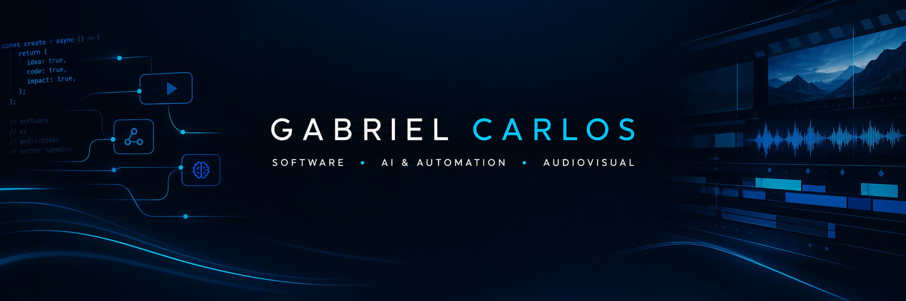

# Gabriel Carlos

### Software · AI & Automation · Audiovisual Technology

[Portfolio](https://gabscarlos.dev.br) · [GitHub](https://github.com/gabscarlos)

---

## 🇧🇷 Sobre mim

Conecto **desenvolvimento de software, inteligência artificial e criatividade** para construir produtos digitais e soluções práticas.

Sou formado em Análise e Desenvolvimento de Sistemas pela Uniube (2024) e tenho mais de 15 anos de experiência em produção audiovisual para televisão, incluindo edição, direção de imagem, videografismo e produção.

Minha atuação combina engenharia de software com experiência em comunicação visual — da construção de aplicações web e mobile à automação de processos e exploração de novas experiências digitais.

## 🇺🇸 About me

I bring together **software development, artificial intelligence, and creativity** to build digital products and practical solutions.

I hold a degree in Systems Analysis and Development from Uniube (2024) and have over 15 years of experience in television and audiovisual production, including editing, image direction, motion graphics, and production.

My work combines software engineering with visual storytelling—from web and mobile applications to workflow automation and new digital experiences.

---

## 🚀 Projetos em destaque · Featured projects

### CheckTreino
Aplicativo de treinamento físico com biblioteca de exercícios, acompanhamento de evolução, gestão de treinos e recursos de IA integrados a automações.

A fitness app featuring an exercise library, workout tracking, training management, and AI capabilities connected to automation workflows.

**Tecnologias / Tech:** React Native · Expo · TypeScript · Firebase · Next.js · n8n

### Diárioo
Plataforma de gestão escolar voltada à digitalização e organização de rotinas educacionais.

A school-management platform focused on digitizing and organizing educational workflows.

**Tecnologias / Tech:** Next.js · React · TypeScript · MongoDB

🔗 [Acessar o Diárioo / Open Diárioo](https://diarioo-mocha.vercel.app/)

### Obscure Rock
Projeto editorial para descobrir e documentar álbuns obscuros de rock psicodélico, progressivo, hard rock e proto-heavy, com atenção especial às décadas de 1960 e 1970.

An editorial project exploring and documenting obscure psychedelic, progressive, hard rock, and proto-heavy albums, especially from the 1960s and 1970s.

**Tecnologias / Tech:** React · Next.js · YouTube embeds · SEO

🔗 [Explorar o Obscure Rock / Explore Obscure Rock](https://obscure-rock.vercel.app/)

---

## 🧰 Tecnologias · Technologies

**Frontend:** JavaScript · TypeScript · React · Next.js · React Native · Expo

**Backend:** Node.js · NestJS · REST APIs

**Data & Services:** Firebase · MongoDB · Supabase · SQL and NoSQL databases

**AI & Automation:** n8n · AI service integrations · workflow automation

**Audiovisual:** Adobe Premiere Pro · After Effects · Photoshop · Blender · 3ds Max · Motion Graphics · Visual Effects · Virtual Sets

---

## 📈 GitHub em números · GitHub at a glance

  
  

---

## 🎯 Foco atual · Current focus

- Evoluir aplicações web e mobile usadas em cenários reais.  
  Building and improving web and mobile applications for real-world use.
- Integrar IA e automação a produtos e fluxos de trabalho.  
  Integrating AI and automation into products and workflows.
- Desenvolver plataformas SaaS com atenção à segurança, arquitetura e usabilidade.  
  Building SaaS platforms with a focus on security, architecture, and usability.
- Explorar a interseção entre software, audiovisual e experiências interativas.  
  Exploring the intersection of software, audiovisual production, and interactive experiences.

---

**Criatividade com estratégia. Tecnologia com propósito.**  
**Creativity with strategy. Technology with purpose.**

[Portfolio](https://gabscarlos.dev.br) · [GitHub](https://github.com/gabscarlos)

